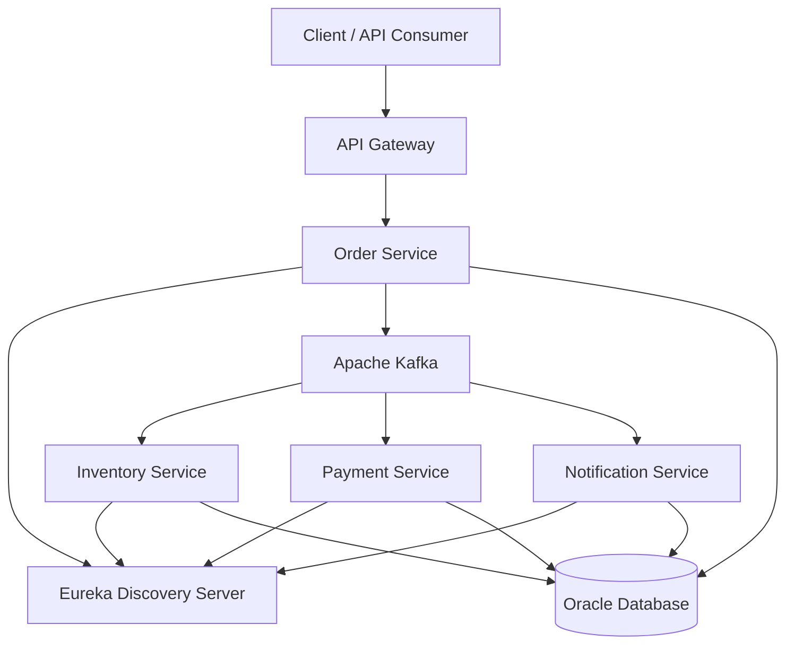
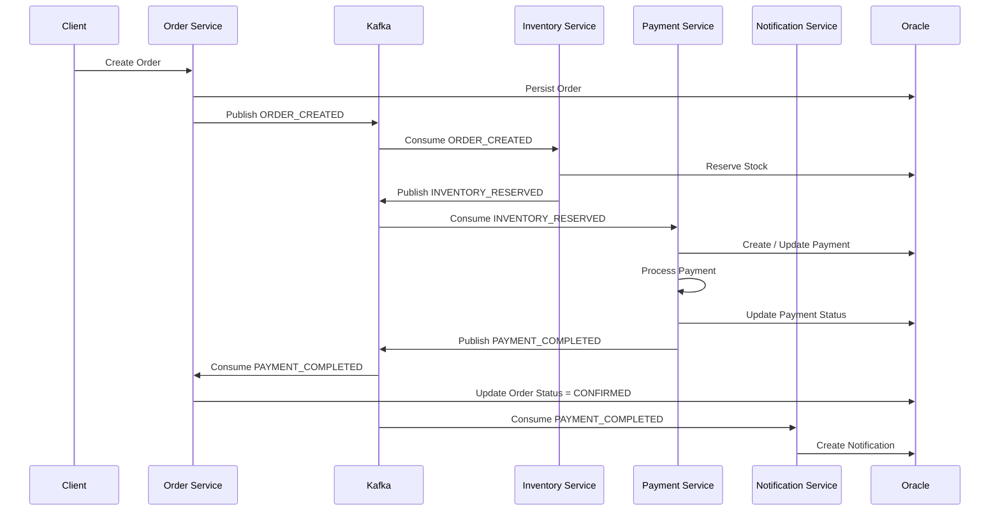
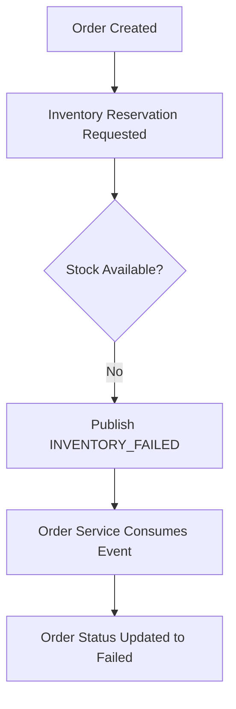
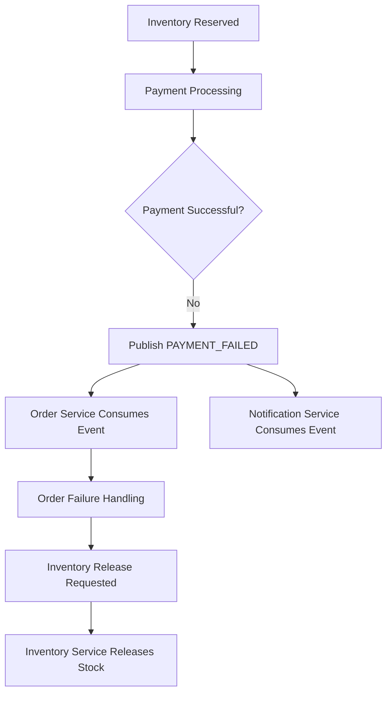
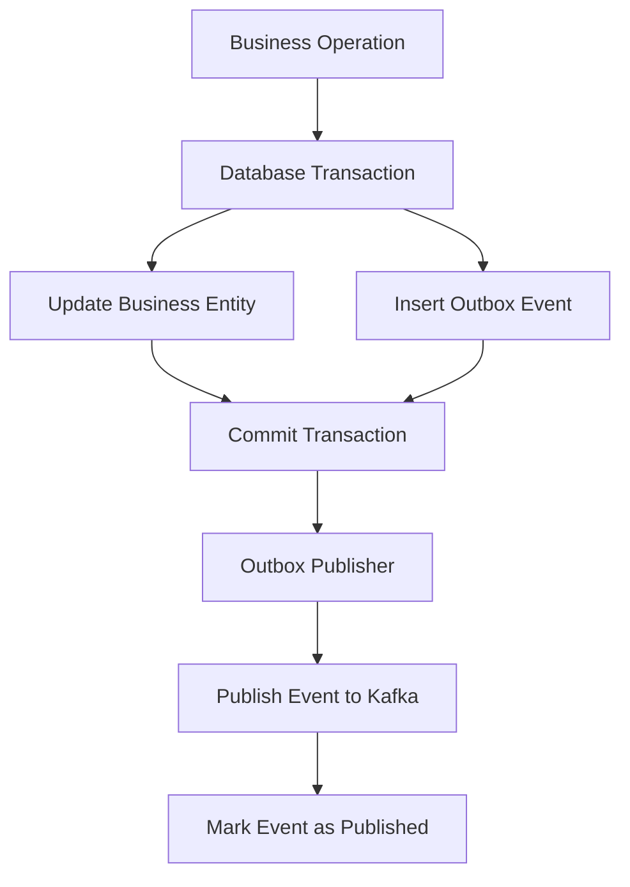

# Enterprise Order Processing System

A distributed, event-driven microservices platform built using Java 21, Spring Boot, Apache Kafka, Oracle Database, and Spring Cloud.

The system simulates an end-to-end order lifecycle, including order creation, inventory reservation, payment processing, and customer notifications. Each business capability is implemented as an independently deployable microservice, communicating asynchronously through Kafka events.

---

## Overview

The Enterprise Order Processing System demonstrates how a traditional monolithic order-processing application can be decomposed into independently deployable microservices with clear business boundaries.

The platform uses asynchronous event-driven communication to coordinate the order lifecycle while maintaining separation of concerns between services.

### Key Features

- Microservices-based architecture
- Event-driven communication using Apache Kafka
- Service discovery using Netflix Eureka
- REST APIs using Spring Boot
- MySQL Database integration using Spring Data JPA and Hibernate
- Transactional Outbox Pattern for reliable event publishing
- Idempotent event processing
- Inventory reservation and release workflows
- Simulated payment processing
- Payment success and failure handling
- Notification persistence and management
- Centralized API documentation using OpenAPI/Swagger at the individual service level
- Application health monitoring using Spring Actuator
- Prometheus metrics exposure
- Connection pooling using HikariCP
- Maven multi-module project structure

---

## Architecture

The platform consists of independently deployable microservices that communicate through REST APIs and Kafka events.

### High-Level Architecture



> Each business microservice owns its data and database schema. Services communicate through well-defined events rather than directly accessing another service's database.

---

## Microservices

| Microservice | Port | Responsibility |
|---|---:|---|
| Discovery Server | 8761 | Service registration and discovery using Eureka |
| API Gateway | 8080 | Entry point for client requests and routing |
| Order Service | 8081 | Order creation, lifecycle management, and orchestration |
| Inventory Service | 8082 | Stock management, reservation, and release |
| Payment Service | 8083 | Payment processing and payment outcome management |
| Notification Service | 8084 | Payment-related customer notification management |

### 1. Discovery Server

The Discovery Server provides service registration and discovery using Netflix Eureka.

Responsibilities:

- Service registration
- Service discovery
- Maintaining service registry
- Supporting dynamic service location

Dashboard:

```text
http://localhost:8761
```

### 2. API Gateway

The API Gateway acts as the entry point for client requests.

Responsibilities:

- Routing requests to downstream microservices
- Centralized entry point for APIs
- Simplifying client-to-service communication

Base URL:

```text
http://localhost:8080
```

### 3. Order Service

The Order Service is responsible for managing the order lifecycle.

Responsibilities:

- Creating orders
- Validating order requests
- Persisting order information
- Initiating inventory reservation
- Processing inventory and payment events
- Maintaining order lifecycle status
- Handling order failures

Port:

```text
8081
```

### 4. Inventory Service

The Inventory Service manages product stock and reservation workflows.

Responsibilities:

- Maintaining inventory
- Reserving stock for orders
- Validating stock availability
- Preventing overselling
- Processing inventory release requests
- Publishing inventory-related events

Port:

```text
8082
```

### 5. Payment Service

The Payment Service handles payment processing for orders.

Responsibilities:

- Initiating payment processing
- Maintaining payment records
- Simulating payment gateway responses
- Processing payment success and failure
- Publishing payment events
- Managing payment-related transactional outbox events

Port:

```text
8083
```

The current implementation uses a simulated payment processor and does not integrate with an external payment gateway.

### 6. Notification Service

The Notification Service consumes payment-related events and creates customer notifications.

Responsibilities:

- Consuming payment success events
- Consuming payment failure events
- Persisting notifications
- Preventing duplicate notifications
- Retrieving notifications
- Retrieving unread notifications
- Marking notifications as read

Port:

```text
8084
```

The current implementation supports database-backed in-app notifications. Email, SMS, and push notification delivery are future enhancements.

---

## Technology Stack

| Technology | Usage |
|---|---|
| Java 21 | Core programming language |
| Spring Boot 3.5.x | Microservice framework |
| Spring Web | REST API development |
| Spring Data JPA | Persistence abstraction |
| Hibernate | ORM and entity management |
| MySQL Database | Relational data storage |
| Apache Kafka | Event-driven communication |
| Spring Kafka | Kafka integration |
| Spring Cloud | Microservice infrastructure |
| Netflix Eureka | Service discovery |
| Spring Cloud Gateway | API Gateway |
| Maven | Multi-module build |
| HikariCP | JDBC connection pooling |
| Spring Actuator | Health checks and monitoring |
| Micrometer | Metrics instrumentation |
| Prometheus | Metrics collection |
| Springdoc OpenAPI | API documentation |
| JUnit 5 | Unit testing |
| Mockito | Mocking and service-layer testing |

---

## Maven Multi-Module Structure

The project is organized as a Maven multi-module application.

```text
enterprise-order-processing-platform
│
├── pom.xml
│
├── common-events
│   └── Shared Kafka event contracts
│
├── discovery-server
│   └── Eureka Discovery Server
│
├── api-gateway
│   └── API Gateway
│
├── order-service
│   └── Order lifecycle management
│
├── inventory-service
│   └── Inventory management
│
├── payment-service
│   └── Payment processing
│
└── notification-service
    └── Customer notifications
```

### Module Responsibilities

| Module | Description |
|---|---|
| `common-events` | Shared event contracts used by microservices |
| `discovery-server` | Eureka service registry |
| `api-gateway` | Central API entry point |
| `order-service` | Order management |
| `inventory-service` | Inventory reservation and release |
| `payment-service` | Payment processing |
| `notification-service` | Notification creation and retrieval |

The `common-events` module contains shared event contracts and is packaged as a JAR dependency for services that require them.

---

## Event-Driven Architecture

Apache Kafka is used for asynchronous communication between business microservices.

Services publish domain events to Kafka topics. Other services consume these events and react independently.

This approach reduces direct coupling between services and supports independent scalability.

### Kafka Topics

| Topic | Producer | Consumer | Purpose |
|---|---|---|---|
| `order.created` | Order Service | Inventory Service | Initiates inventory reservation |
| `order.confirmed` | Order Service | Other consumers (if configured) | Order confirmation event |
| `order.failed` | Order Service | Other consumers (if configured) | Order failure event |
| `inventory.reserved` | Inventory Service | Payment Service, Order Service | Indicates successful reservation |
| `inventory.failed` | Inventory Service | Order Service | Indicates reservation failure |
| `inventory.release.requested` | Order Service | Inventory Service | Requests inventory release |
| `inventory.released` | Inventory Service | Order Service | Confirms inventory release |
| `payment.requested` | Payment-related flow, if configured | Payment Service | Payment initiation event |
| `payment.completed` | Payment Service | Order Service, Notification Service | Indicates successful payment |
| `payment.failed` | Payment Service | Order Service, Notification Service | Indicates payment failure |

> Kafka topics represent asynchronous integration contracts between services. Event contracts are maintained in the `common-events` module.

---

## End-to-End Order Processing Workflow

### Successful Order Flow



### Failed Inventory Reservation



### Failed Payment



---

## Transactional Outbox Pattern

The Order, Inventory, and Payment services use the Transactional Outbox Pattern for event publishing.

The purpose of this pattern is to prevent inconsistencies between database transactions and event publishing.

### Problem

Consider the following scenario:

1. A service updates its database successfully.
2. The service attempts to publish an event to Kafka.
3. Kafka is temporarily unavailable.
4. The database transaction has committed, but the event was not published.

This creates inconsistency between the database state and downstream services.

### Solution

The service stores business changes and the corresponding event in the same database transaction.



### Outbox Lifecycle

```text
PENDING
   |
   v
PROCESSING
   |
   v
PUBLISHED
```

On failure, events are retried according to the configured retry policy.

The Outbox Pattern provides reliable event publication and minimizes the risk of losing business events when Kafka is temporarily unavailable.

---

## Database Architecture

Each business microservice maintains its own database schema.

| Service | Database / Schema |
|---|---|
| Order Service | `ORDER_DB` |
| Inventory Service | `INVENTORY_DB` |
| Payment Service | `PAYMENT_DB` |
| Notification Service | `NOTIFICATION_DB` |

### Database Design Principles

- Database ownership per microservice
- No direct cross-service database access
- Service-specific persistence models
- Transactional data updates
- UUID-based identifiers
- Oracle `RAW(16)` storage for UUIDs where configured
- Indexing for frequently queried fields
- Idempotency constraints for event processing

The database-per-service approach maintains service boundaries and allows individual microservices to evolve their schemas independently.

---

## Idempotency and Duplicate Event Handling

Kafka consumers may receive the same event more than once.

The services implement idempotency mechanisms to prevent duplicate business operations.

Examples include:

- Duplicate order processing prevention
- Duplicate inventory reservations prevention
- Payment uniqueness per order
- Notification uniqueness per event
- Event ID validation
- Database unique constraints

Idempotency ensures that processing the same event multiple times does not unintentionally duplicate the corresponding business operation.

---

## API Documentation

Each microservice exposes its own Swagger UI and OpenAPI specification.

| Service | Swagger URL |
|---|---|
| Order Service | `http://localhost:8081/swagger-ui.html` |
| Inventory Service | `http://localhost:8082/swagger-ui.html` |
| Payment Service | `http://localhost:8083/swagger-ui.html` |
| Notification Service | `http://localhost:8084/swagger-ui.html` |

OpenAPI JSON is available at:

```text
http://localhost:<service-port>/api-docs
```

---

## Monitoring and Observability

The microservices expose health checks and metrics through Spring Boot Actuator.

### Health Checks

```text
http://localhost:8081/actuator/health
http://localhost:8082/actuator/health
http://localhost:8083/actuator/health
http://localhost:8084/actuator/health
```

### Prometheus Metrics

```text
http://localhost:8081/actuator/prometheus
http://localhost:8082/actuator/prometheus
http://localhost:8083/actuator/prometheus
http://localhost:8084/actuator/prometheus
```

Metrics include JVM, HTTP request, application, and infrastructure metrics supported by the configured Micrometer instrumentation.

---

## Logging

Each service maintains its own logging configuration and log files.

The logging framework is designed to provide separation of concerns across microservices.

### Logging Objectives

- Independent log files per service
- Application-level INFO logs
- Error-level logging for failures
- Kafka producer and consumer visibility
- Business-event traceability
- Reduced Hibernate SQL noise
- Separate error logging

Hibernate SQL logging is disabled by default to keep logs readable.

---

## Prerequisites

Install the following before running the application:

- Java 21 JDK
- Maven 3.9+
- Oracle Database
- Apache Kafka
- Git

Verify Java:

```bash
java -version
```

Verify Maven:

```bash
mvn -version
```

---

## Environment Configuration

The application uses `application.properties` files.

Sensitive credentials and environment-specific configuration should be supplied through environment variables.

### Oracle Database

Example configuration:

```properties
ORDER_DB_URL=jdbc:oracle:thin:@//localhost:1521/FREEPDB1
INVENTORY_DB_URL=jdbc:oracle:thin:@//localhost:1521/FREEPDB1
PAYMENT_DB_URL=jdbc:oracle:thin:@//localhost:1521/FREEPDB1
NOTIFICATION_DB_URL=jdbc:oracle:thin:@//localhost:1521/FREEPDB1
```

### Kafka

```properties
KAFKA_BOOTSTRAP_SERVERS=localhost:9092
```

### Eureka

```properties
EUREKA_URL=http://localhost:8761/eureka/
```

---

## Build Instructions

Clone the repository:

```bash
git clone https://github.com/<your-username>/enterprise-order-processing-system.git
```

Navigate to the project root:

```bash
cd enterprise-order-processing-system
```

### Build All Modules

```bash
mvn clean install -DskipTests
```

### Build a Specific Service and Its Dependencies

```bash
mvn -pl order-service -am clean install -DskipTests
```

Example for Payment Service:

```bash
mvn -pl payment-service -am clean install -DskipTests
```

Example for Notification Service:

```bash
mvn -pl notification-service -am clean install -DskipTests
```

### Run Tests

Run tests across all modules:

```bash
mvn test
```

Run tests for an individual service:

```bash
mvn -pl order-service test
```

---

## Startup Sequence

Start the infrastructure and services in the following order.

### 1. Start Oracle Database

Ensure Oracle is running and all service schemas have been created.

### 2. Start Apache Kafka

Ensure Kafka is running and accessible at:

```text
localhost:9092
```

### 3. Start Eureka Discovery Server

```bash
mvn -pl discovery-server spring-boot:run
```

Verify:

```text
http://localhost:8761
```

### 4. Start API Gateway

```bash
mvn -pl api-gateway spring-boot:run
```

### 5. Start Order Service

```bash
mvn -pl order-service spring-boot:run
```

### 6. Start Inventory Service

```bash
mvn -pl inventory-service spring-boot:run
```

### 7. Start Payment Service

```bash
mvn -pl payment-service spring-boot:run
```

### 8. Start Notification Service

```bash
mvn -pl notification-service spring-boot:run
```

---

## Service URLs

| Component | URL |
|---|---|
| Eureka Dashboard | http://localhost:8761 |
| API Gateway | http://localhost:8080 |
| Order Service | http://localhost:8081 |
| Inventory Service | http://localhost:8082 |
| Payment Service | http://localhost:8083 |
| Notification Service | http://localhost:8084 |

---

## Testing the End-to-End Workflow

### Successful Order

1. Start Oracle Database.
2. Start Kafka.
3. Start Discovery Server.
4. Start API Gateway.
5. Start Order Service.
6. Start Inventory Service.
7. Start Payment Service.
8. Start Notification Service.
9. Create an order using the Order Service REST API or API Gateway.
10. Verify the order is created.
11. Verify inventory is reserved.
12. Verify the Payment Service processes the payment.
13. Verify payment status becomes `SUCCESS`.
14. Verify the Order Service receives the payment completion event.
15. Verify the order status becomes `CONFIRMED`.
16. Verify the Notification Service creates a notification.

### Failure Scenarios

The platform can be tested for scenarios such as:

- Insufficient inventory
- Payment failure
- Kafka unavailability
- Database connectivity failures
- Duplicate Kafka event delivery
- Outbox retries
- Inventory release and compensation workflows

---

## Design Principles

The project follows these architectural principles:

- Single responsibility per microservice
- Loose coupling through asynchronous messaging
- Independent service deployment
- Database ownership per service
- Event-driven communication
- Idempotent event processing
- Resilient event publishing using the Outbox Pattern
- Separation of business logic, persistence, messaging, and API layers
- Centralized service discovery
- Observability through metrics and health checks

---

## Future Enhancements

Potential improvements to the platform include:

- Docker and Docker Compose support
- Kubernetes deployment
- Centralized configuration using Spring Cloud Config
- API authentication and authorization using OAuth2/JWT
- Distributed tracing using OpenTelemetry
- Centralized logging using ELK or Loki
- Resilience4j circuit breakers and retries
- Kafka Dead Letter Topics
- Real payment gateway integration
- Email, SMS, and push notification integrations
- Customer identity integration
- Pagination and filtering for notifications
- Integration testing using Testcontainers
- CI/CD using GitHub Actions
- Grafana dashboards
- Saga orchestration enhancements
- Improved outbox leasing, locking, and multi-instance concurrency handling

---

## Project Status

| Component | Status |
|---|---|
| Common Events | Implemented |
| Discovery Server | Implemented |
| API Gateway | Implemented |
| Order Service | Implemented |
| Inventory Service | Implemented |
| Payment Service | Implemented |
| Notification Service | Implemented |
| Kafka Event Integration | Implemented |
| Transactional Outbox | Implemented in business services |
| Oracle Integration | Implemented |
| Swagger Documentation | Implemented |
| Actuator & Prometheus | Implemented |

